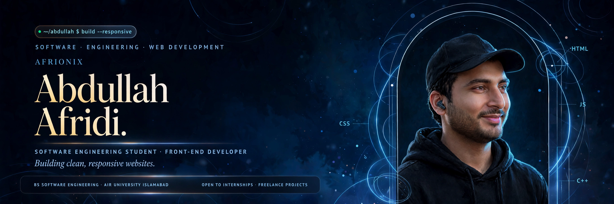
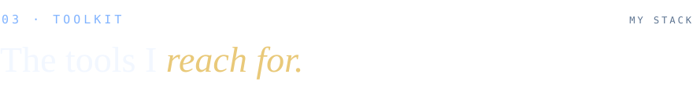
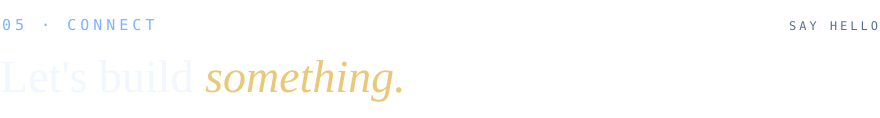

  
  
  
  

  
  

Software Engineering student at **Air University, Islamabad**. I build clean, responsive websites with **HTML, CSS & JavaScript**, and I'm currently levelling up into full-stack development with **Node.js**. Open to internships & freelance projects.

**🧮 Calculator** — a clean, responsive calculator built with HTML, CSS & JavaScript, from my first semester.

  

**🎮 Tetris** — classic Tetris in C++. Being cleaned up — repo coming soon.

**Comfortable with**

  

**Currently learning**

  

  

<picture>
  <source media="(prefers-color-scheme: dark)" srcset="https://raw.githubusercontent.com/abdullahafrididev/abdullahafrididev/output/github-contribution-grid-snake-dark.svg"/>
  <source media="(prefers-color-scheme: light)" srcset="https://raw.githubusercontent.com/abdullahafrididev/abdullahafrididev/output/github-contribution-grid-snake.svg"/>
  
</picture>

  

  
  
  
  

