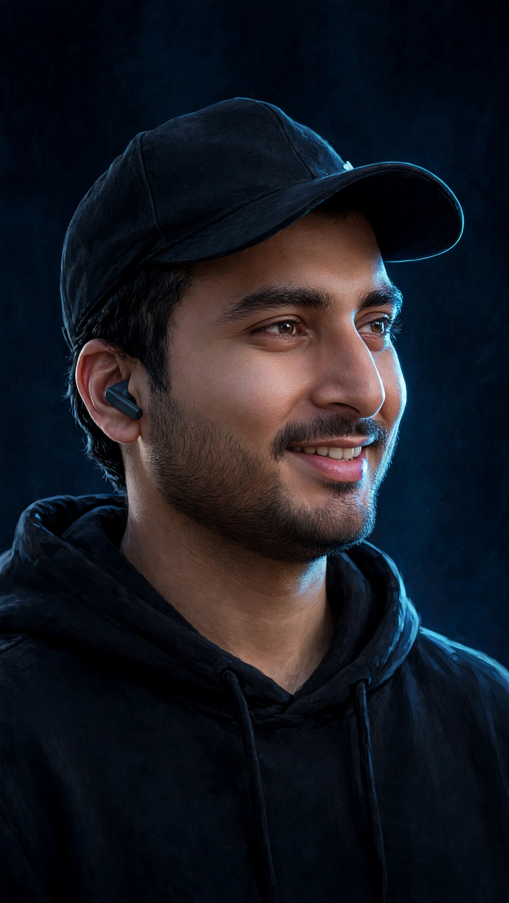

<p align="center">
  
</p>

<h1 align="center"><code>Abdullah Afridi</code></h1>

<p align="center"><b>AFRIONIX</b> · Software Engineering Student · Front-End Developer</p>

<p align="center">
  <a href="https://www.linkedin.com/in/abdullahafridi01"></a>
  <a href="mailto:afridiabdullah.dev@gmail.com"></a>
</p>

<p align="center">
  
  
</p>

---

## ~/ whoami

```bash
$ cat about.txt
> Abdullah Afridi — Software Engineering student at Air University, Islamabad.
> I build clean, responsive websites with HTML, CSS & JavaScript,
> and I'm growing into full-stack development through a real project:
> RAKAN ERP, an inventory & invoicing system for my father's business.
> Currently learning: Node.js.
> Status: open to internships & freelance projects.
```

---

## 02 · Tech Stack

**Comfortable with**

<p>
  
</p>

**Currently learning** — through the RAKAN ERP build

<p>
  
</p>

---

## 03 · Projects

- **🧮 [Calculator](https://github.com/abdullahafrididev/calculator-project)** — a clean, responsive calculator built with HTML, CSS & JavaScript.
- **🏢 RAKAN ERP** *(private, in progress)* — inventory, invoicing & accounts system for a real dental-supplies business in Saudi Arabia. Next.js · TypeScript · PostgreSQL. Design phase complete, build in progress.
- **🎮 Tetris** — classic Tetris in C++. Being cleaned up — repo coming soon.

---

## 04 · GitHub Stats

<p align="center">
  
  
</p>

<p align="center">
  
</p>

---

## 05 · Contribution Snake

<picture>
  <source media="(prefers-color-scheme: dark)" srcset="https://raw.githubusercontent.com/abdullahafrididev/abdullahafrididev/output/github-contribution-grid-snake-dark.svg"/>
  <source media="(prefers-color-scheme: light)" srcset="https://raw.githubusercontent.com/abdullahafrididev/abdullahafrididev/output/github-contribution-grid-snake.svg"/>
  
</picture>


